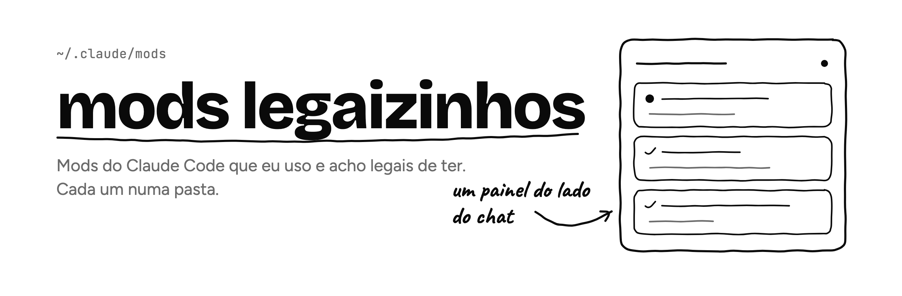

<picture>
  <source media="(prefers-color-scheme: dark)" srcset="assets/banner-dark.png">
  
</picture>

| Mod | O que faz |
|---|---|
| [subagentes](subagentes) | Painel com cada subagente e tarefa da sessão: status, modelo, tokens, custo estimado e linhas alteradas |

## Como instalar um mod

Clone o repositório e copie a pasta do mod que você quiser para `~/.claude/mods`:

```bash
git clone https://github.com/luecabral/mods-legaizinhos
cp -R mods-legaizinhos/subagentes ~/.claude/mods/subagentes
```

Depois recarregue o Claude Code.
