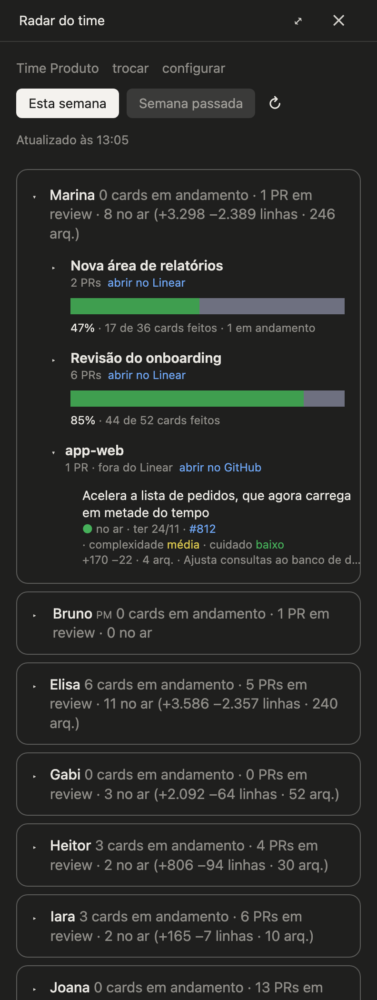

<p align="center">
  
</p>

# Radar do time

Mostra, em linguagem simples, o que o seu time de produto está fazendo: os PRs de cada pessoa nos repositórios da sua org do GitHub (resumidos para quem não é técnico, com tamanho, complexidade e cuidado) e, se você quiser, os cards do Linear em andamento, agrupados por projeto e com o progresso de cada um. Avisa quando sai PR novo ou quando um PR vai para o ar.

Funciona para qualquer empresa: nada do time vem no código. Você monta tudo no próprio painel e a configuração fica só no seu computador.

## Como usar

1. Numa sessão do Claude Code, digite `/radar` e mande.
2. Na primeira vez, o painel pede a **org do GitHub** e, se quiser, o **workspace do Linear** (o trecho de `linear.app/<workspace>`) e alguns termos extras do seu negócio (ex.: `cashback, fidelidade`) para marcar PRs sensíveis.
3. Em seguida lista os membros da org. Dê um nome ao time, marque as pessoas, ajuste o nome de exibição, o e-mail do Linear (opcional) e quem é PM. Salve o time e clique em **concluir**. Dá para montar vários times.
4. Para mudar depois, clique em **configurar** no topo do painel: edite, remova ou crie times, troque a org ou o workspace.
5. Alterne entre **Esta semana** e **Semana passada**. O botão ↻ busca de novo.

## O que precisa estar pronto

- **GitHub CLI** (`gh`) instalado e logado (`gh auth login`), com acesso à org.
- **Linear** (opcional): conecte o Linear no Claude e informe o workspace na configuração. Sem isso, o painel funciona só com o GitHub.

Os resumos e as notas de complexidade são feitos pelo Haiku, na conta de quem usa. Os horários seguem o fuso do seu computador.

## Instalar

```
/plugin marketplace add <dono>/<repositório>
/plugin install radar-time
```

## Desenvolvimento

- `claude plugin test .` roda os testes.
- `scripts/verifica-sem-dados.sh` falha se algum dado de uma empresa específica (org, logins, e-mails) aparecer no código.
