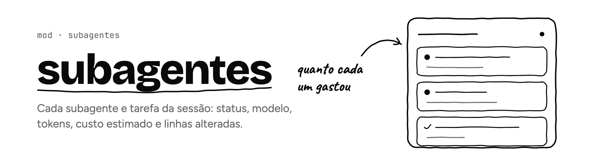

<picture>
  <source media="(prefers-color-scheme: dark)" srcset="../assets/subagentes-dark.png">
  
</picture>

Mod do Claude Code que abre o **Painel da sessão** na lateral, no mesmo visual do painel nativo do app. De cima pra baixo:

- **Limites do Claude:** uso do limite da sessão (5 h) e do semanal, com barrinha e horário de reinício
- **Alterações:** diff da branch contra a base (commits, arquivos alterados e novos) e todos os PRs por onde a sessão passou, com repo, número, `+/−`, checks ("● 3/6" ou "1 falhando") e ícone por estado (aberto, rascunho, mergeado, fechado)
  - botões **Criar PR**, **Marcar como pronto** e **Corrigir CI**, e um menu ⋯ com abrir no GitHub, voltar pra rascunho, revisar o PR e copiar o link
  - aviso e notificação do sistema quando um PR é mergeado ou fechado
- **Sessão principal:** modelo, esforço, há quanto tempo está aberta e o que está fazendo agora
- **Subagentes e tarefas:** cada subagente, tarefa em segundo plano e execução do Gemini CLI, com status, tempo, modelo, tokens e custo
- **Sessões aninhadas:** as sessões que esta abriu, separadas até você mesclar
- **Custo desta sessão:** total, principal, subagentes, Gemini e mescladas, em US$ e tokens
- **Longe do computador:** um botão que pede pra sessão ligar o controle remoto e manter o computador acordado enquanto ela trabalha

Abre com `/painel` (ou `/subagentes`, o nome antigo). Os PRs vêm do `gh` e do `git` da pasta da sessão, então precisa do [GitHub CLI](https://cli.github.com) logado.

Os preços ficam em `hooks/prices.ts` (US$ por milhão de tokens). Ajuste lá se a tabela mudar.

## Como instalar

Copie esta pasta para `~/.claude/mods/subagentes`:

```bash
git clone https://github.com/luecabral/mods-legaizinhos
cp -R mods-legaizinhos/subagentes ~/.claude/mods/subagentes
```

Depois recarregue o Claude Code.

## Estrutura

- `.claude-plugin/plugin.json`: manifesto do mod
- `hooks/register.tsx`: painel, PRs e leitura dos eventos
- `hooks/sessions.ts`: números por sessão
- `hooks/prices.ts`: tabela de preços
- `hooks/gemini-cli.ts`: leitura dos eventos do Gemini CLI
- `types/index.d.ts`: tipos do mod
- `.claude-plugin/types/`: tipos do Claude Code, gerados pelo app (fora do repositório)
